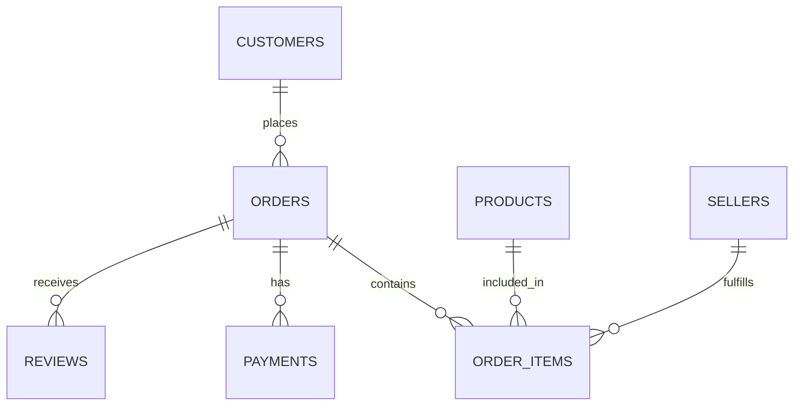

# SalesPulse: Retail Business Analytics with SQL

## Problem

SalesPulse analyzes retail sales data to answer business questions about revenue, customers, products, regions, payments, and delivery performance.

## Dataset

This project uses the Brazilian E-Commerce Public Dataset by Olist.

Dataset source:

https://www.kaggle.com/datasets/olistbr/brazilian-ecommerce

The dataset contains orders, customers, products, sellers, payments, reviews, and product categories.

## Tools

- DuckDB
- SQL
- Google Colab
- Looker Studio
- GitHub

DuckDB was used instead of PostgreSQL because the task allowed DuckDB and it does not require a database server.

## Database structure

The project uses:

- `fact_sales`: one row per order item
- `order_summary`: one row per order

Relationships:

## SQL analysis

The project contains 27 documented business questions covering:

- Revenue trends
- Top categories and products
- Regional performance
- Payment methods
- Customer lifetime revenue
- Repeat customers
- Delivery delays
- Month-over-month growth
- Running totals
- Moving averages
- Top categories by month
- Customer order sequences

The project includes more than eight CTE queries and more than six window-function queries.

## Metric definitions

- Revenue is the sum of `item_revenue` from `fact_sales`.
- Revenue represents item prices only and excludes freight charges.
- The order count is the number of distinct `order_id` values in `fact_sales`: 99,441 orders.
- Average order value is calculated as revenue divided by the order count: 136.68.
- Customer count is the number of distinct `customer_unique_id` values: 96,096 customers.
- Revenue includes all order statuses, including delivered, canceled, and unavailable orders.
- Delivery metrics use the one-row-per-order `order_summary` view and include delivered orders with non-null delivery dates.
- Monthly trend analysis uses January 2017 through August 2018 to exclude incomplete months.

## Key findings

1. Total revenue was **13,591,643.70** across **99,441 orders**.

2. The company served **96,096 unique customers**.

3. The top product category was **health_beauty**, generating **1,258,681.34** in revenue.

4. The highest-revenue customer region was **SP**, generating **5,202,955.05**.

5. The highest-revenue month was **November 2017**, generating **1,010,271.37**.

6. The late-delivery rate among delivered orders was **8.11%**.

7. The repeat-customer rate was **3.12%**.

## Recommendations

1. Prioritize inventory and marketing for high-performing categories such as health_beauty, watches_gifts, and bed_bath_table.

2. Focus regional campaigns and logistics planning on high-revenue states, especially SP, RJ, and MG.

3. Improve customer retention through follow-up campaigns, loyalty incentives, and personalized offers because the repeat-customer rate was 3.12%.

## Dashboard

[Open the SalesPulse dashboard](https://datastudio.google.com/reporting/24616813-7585-4755-8672-4e6d4428afeb/page/okCDG)

The dashboard contains:

- Total revenue
- Total orders
- Unique customers
- Total freight cost
- Monthly revenue
- Revenue by category
- Revenue by region
- Late-delivery rate
- Date, region, and category filters

## Validation

The project validates:

- Row counts before and after joins
- Distinct order counts
- Distinct customer counts
- Revenue totals between item-level and order-level views
- Duplicate order IDs

The `order_summary` view contains one row per order, preventing duplicate-inflated totals.

## Limitations

- The dataset contains historical Brazilian e-commerce activity.
- DuckDB was used instead of PostgreSQL.
- Looker Studio was used as the dashboard equivalent because Metabase Cloud required a business email and Docker could not be installed.
- Recommendations describe patterns in the data and do not prove causation.
- Revenue is not the same as profit because costs and margins are unavailable.

## Files

- `salespulse_queries.sql`
- `salespulse_dashboard.csv`
- `SalesPulse_Week2_SQL.ipynb`
- `README.md`

## Demo video

[Watch the SalesPulse walkthrough](https://www.loom.com/share/0c0e7e404d334d7eaa9b075ecc3efc31)

## Repository

https://github.com/hdrsanalytics/salespulse-retail-sql
